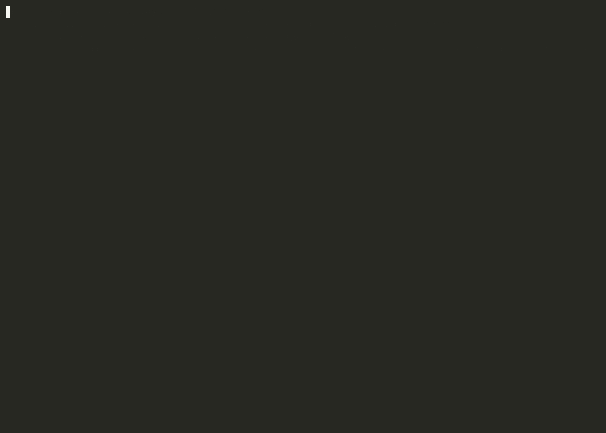

# go2-npu-unlock



*Qwen3.5-2B running on a Go2's NPU with driver 0.9.8, recorded on the robot in real time
(`examples/llm/rkllm_chat.py`, pauses between prompts shortened).*

Turn on the **6 TOPS NPU** inside the Unitree **Go2** and run it with Rockchip's current
NPU driver, **rknpu 0.9.8**. That driver is what Rockchip's LLM runtime (**rknn-llm**) requires,
so a Go2 can run language models like Qwen3.5 locally.

- **No flashing.** Nothing is written to any partition. The Go2's secure boot stays untouched.
- **One package for every board revision.** It detects whether your board has the NPU voltage
  regulator and picks the matching configuration.
- **Reversible.** A reboot without the service, or `./uninstall.sh` plus a reboot, restores the stock state.

## Why the NPU is off on a stock Go2

The Go2's main computer is a Rockchip **RK3588**. Its kernel has an NPU driver built in
(rknpu **0.8.2**, from 2022), but the device tree ships the NPU and its IOMMU **disabled**, so
nothing can use it. That old driver is also too old for rknn-llm, and Rockchip's official way to get
a newer one is to rebuild and reflash the kernel, which a secure-boot Go2 won't boot.

This package does it at runtime instead:

1. `rknpu2.ko` is Rockchip's rknpu **0.9.8** driver, ported to build as a loadable module for the
   Go2's exact kernel (`5.10.176-rt86+`). It registers under its own name, so the built-in 0.8.2
   driver never touches the NPU.
2. `go2_npu_overlay.ko` applies a small device-tree overlay that switches the NPU on and points it
   at the new driver.

## Supported

| Go2 kernel build (`uname -v`) | Board | NPU power | Result |
|---|---|---|---|
| `#74 SMP PREEMPT_RT Wed Oct 16 15:26:07 CST 2024` | newer revision | RK8602 regulator on I2C: **full voltage scaling** | 300 MHz – 1 GHz, 1 GHz at 812.5 mV |
| `#2 SMP PREEMPT_RT Mon Nov 27 07:19:33 UTC 2023` | older revision | no regulator on I2C: **fixed ~800 mV rail** | same speed as the newer board |

Other kernel builds are refused by default; see [Other firmware](#other-firmware).

## Install

You need root SSH access to the robot.

```bash
# on your PC
scp -r go2-npu-unlock root@<robot-ip>:/root/

# on the robot
cd /root/go2-npu-unlock
./install.sh --now      # installs, enables at boot, and starts it now if that is safe
go2-npu status
```

Expected:

```
go2-npu 1.0.0
kernel:    5.10.176-rt86+ #74 SMP PREEMPT_RT Wed Oct 16 15:26:07 CST 2024
driver:    RKNPU driver: v0.9.8
board:     dvfs (RK8602 NPU regulator)
governor:  rknpu2_ondemand (8 steps, 300-1000 MHz)
clock:     1000 MHz
voltage:   812 mV
power:     off
load:      Core0:  0%, Core1:  0%, Core2:  0%,
temp:      33 C
device:    /dev/dri/renderD129
```

`power: off` is normal: the NPU powers itself down between jobs.

If `install.sh --now` says it won't start now (for example because an older experiment already
enabled the NPU in this boot), reboot. The service starts it on every boot.

Before installing, `./go2-npu detect` runs every check and says what it would do, without changing anything.

## Commands

| | |
|---|---|
| `go2-npu status` | driver version, board type, clock, voltage, load, temperature |
| `go2-npu detect` | run all checks, change nothing |
| `systemctl start go2-npu` | what runs at boot (`go2-npu start`) |
| `touch /opt/go2-npu/DISABLE` | keep the NPU off from the next boot on (remove the file to re-enable) |
| `./uninstall.sh` | remove everything, then reboot |

## Test it

Any program built on Rockchip's **librknnrt** (rknn-toolkit2 **2.3.x** or **2.5.0**, both tested)
or **librkllmrt** (rknn-llm **1.3.1**) works. For an LLM, see [`examples/llm`](examples/llm/README.md):

```bash
cd examples/llm && ./setup.sh          # downloads Rockchip's runtime, builds the benchmark
python3 rkllm_chat.py models/Qwen3.5-2B_w8a8_rk3588.rkllm
```

## Measured performance

Both board revisions perform the same. Vision, rknn_benchmark, outputs bit-identical to the old 0.8.2 driver:

| Model | 1 NPU core | 3 NPU cores |
|---|---|---|
| MobileNet v1 (224×224) | 486 FPS | |
| YOLOv5s (640×640) | 62 FPS | 93 FPS |

LLM, rknn-llm 1.3.1, W8A8, 4096 context, 128 generated tokens:

| Model | File | RAM | Decode, stock | Decode, performance mode |
|---|---|---|---|---|
| Qwen3.5-0.8B | 1.3 GB | 1.1 GB | 14.7 tok/s | 17.6 tok/s |
| Qwen3.5-2B | 2.9 GB | 2.2 GB | 8.6 tok/s | 10.1 tok/s |
| Qwen3.5-4B | 5.5 GB | 4.7 GB | 4.1 tok/s | 4.75 tok/s |

Performance mode = CPU governor `performance`, deep CPU idle off, NPU fixed at 1 GHz (`/perf` in the
chat app). The Go2's memory runs at a fixed 1848 MHz, which is what limits LLM speed.

## Safety notes

- **Never `rmmod` these modules.** Removing the overlay tears down the NPU under its users and hangs
  the board. `go2_npu_overlay.ko` has no unload function for this reason; reboot instead.
- **Don't apply other device-tree overlays** with this loader. On this 5.10 kernel an overlay that the
  kernel rejects is freed twice and panics the board.
- On the older board revision the NPU rail is fixed. The NPU clock is a ring oscillator that tracks
  the voltage, so the 800 MHz, 900 MHz and 1 GHz settings all give the same clock there, and it can't
  run faster than the silicon allows at that voltage.
- Unitree's own software doesn't use the NPU, so enabling it changes nothing about how the robot walks.

## Other firmware

The driver only works on a kernel whose internal layout matches the one it was built for. On any
other kernel build `go2-npu` refuses to load. If your Go2 runs `5.10.176-rt86+` with a different
build string and you want to try:

```bash
go2-npu detect                     # see what it finds
touch /opt/go2-npu/FORCE           # allow unknown builds
systemctl start go2-npu
```

The kernel's own symbol-version check still rejects the driver if the kernel differs in a way it
can detect; in that case nothing is loaded. Please report the result with your `uname -v` and `dmesg`.

## Layout

```
go2-npu                 the control script (start / detect / status)
install.sh uninstall.sh
systemd/go2-npu.service
modules/rknpu2.ko       rknpu 0.9.8 for 5.10.176-rt86+
modules/go2_npu_overlay.ko
overlays/npu-dvfs.*     newer board: NPU + IOMMU on, driver compatible
overlays/npu-fixed.*    older board: also a fixed 800 mV regulator, 900 MHz / 1 GHz at 800 mV
src/rknpu2/             driver source as built (Rockchip rknpu 0.9.8 + Go2 port patch)
src/go2_npu_overlay/    overlay loader source
build/                  everything needed to rebuild both modules (see below)
examples/llm/           chat app with live metrics, benchmark, model conversion
```

## How the driver was ported

Rockchip's rknpu 0.9.8, exactly as published in Rockchip's kernel on GitHub
([`rockchip-linux/kernel` @ `276af44f9a7b`](https://github.com/rockchip-linux/kernel/tree/276af44f9a7be47a2804ecabf37f8898541d244e/drivers/rknpu),
"driver: rknpu: Update rknpu driver, version: 0.9.8"), with
[`src/rknpu2/0001-go2-module-port.patch`](src/rknpu2/0001-go2-module-port.patch):

- **Renamed** driver, devfreq governor (`rknpu2_ondemand`) and DT compatible
  (`rockchip,rk3588-rknpu-mod`), so it coexists with the built-in 0.8.2 driver. The module object
  must be called `rknpu2`; the built-in driver already owns `rknpu`.
- **Three kernel functions** the driver needs are not exported by the Go2 kernel
  (`__dma_map_area`, `__dma_unmap_area`, `iommu_setup_dma_ops`). `go2-npu` reads their addresses
  from `/proc/kallsyms` and passes them as module parameters (`rknpu_compat.h`).
- **Built against a reconstruction of the Go2 kernel:** kernel.org `v5.10.176-rt86` with Rockchip's
  late-2022 drivers ported in (from `rockchip-linux/kernel` branch `develop-5.10`, December 2022), the
  Go2's `/proc/config.gz`, and a `Module.symvers` holding the exact symbol CRCs read out of the
  robot's kernel image. Every symbol the module imports matches the robot's kernel.

`include/linux/version_compat_defs.h` is the copy from `rockchip-linux/kernel` `develop-5.10`.
Rockchip also ships the same driver version as a tarball in
[rknn-llm](https://github.com/airockchip/rknn-llm/tree/release-v1.3.1/rknpu-driver)
(`rknpu_driver_0.9.8_20241009.tar.bz2`).

## Building from source

```bash
git clone --depth 1 --branch v5.10.176-rt86 \
    https://git.kernel.org/pub/scm/linux/kernel/git/rt/linux-stable-rt.git linux
build/build.sh linux aarch64-none-linux-gnu-     # Arm GNU Toolchain 10.3-2021.07
```

| `build/` | |
|---|---|
| `kernel-recon.patch.xz` | the Rockchip drivers and headers the Go2 kernel carries, on top of `v5.10.176-rt86` |
| `kbuild.config` | the kernel configuration used for the build |
| `go2-proc-config.gz.txt` | the robot's own `/proc/config.gz`, for reference |
| `Module.symvers` | the symbol CRCs of the robot's kernel |

The script applies the patch, prepares the kernel and builds both modules into `build/out/`, without
debug info. Built this way from a clean checkout, both modules match the ones in `modules/` in
everything the kernel loads (code, data, symbol versions and module info); only the GNU build ID
differs between build machines.

## License

- **This package and both kernel modules:** GPL-2.0, see [LICENSE](LICENSE). The rknpu driver is
  © Rockchip Electronics Co., Ltd., GPL-2.0; files changed for the Go2 port say so in their header.
- **Rockchip runtimes** (`librknnrt`, `librkllmrt`) and the rknn-llm calibration data are not included.
  They are downloaded from Rockchip's GitHub and stay under Rockchip's licences.
- Unitree, Go2, Rockchip and RK3588 are trademarks of their owners; this project is not affiliated
  with either company.
